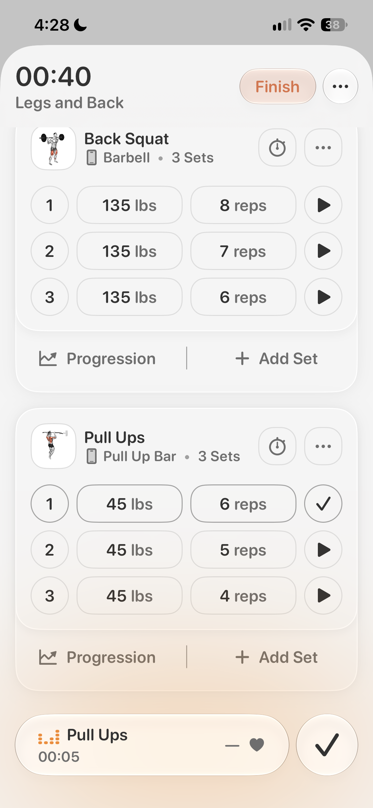
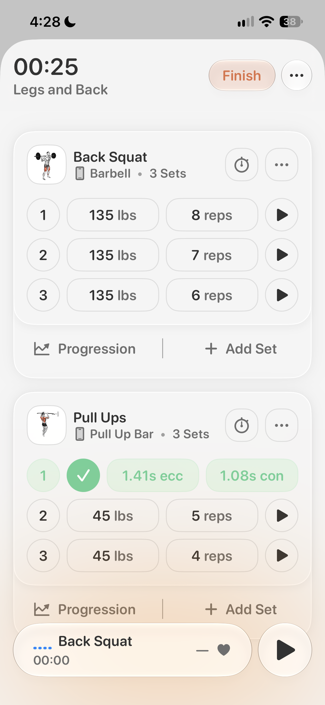
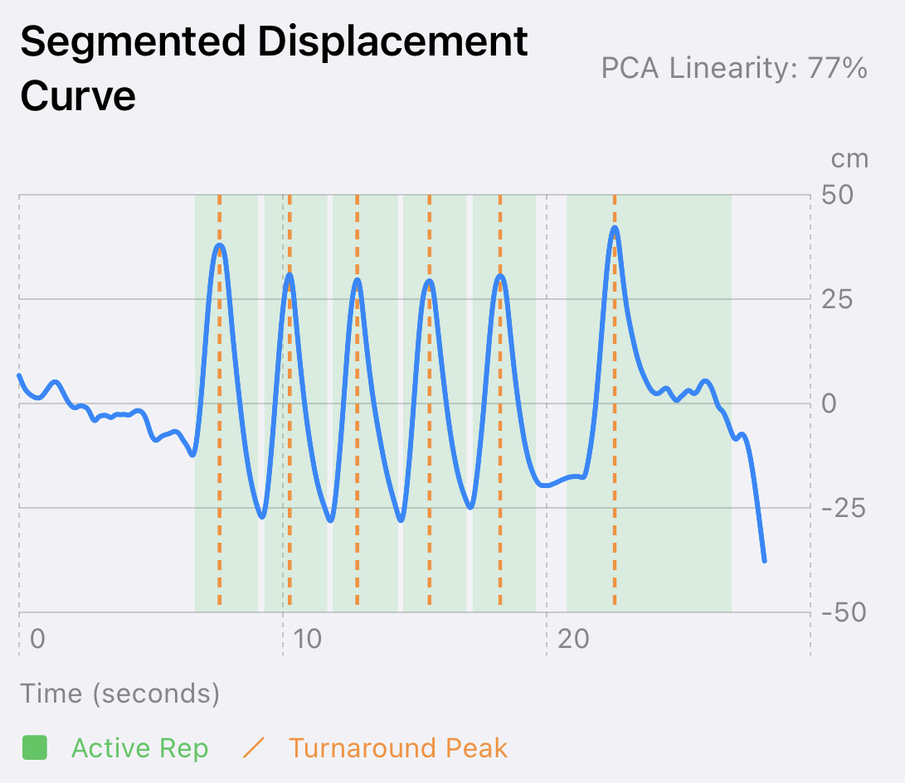
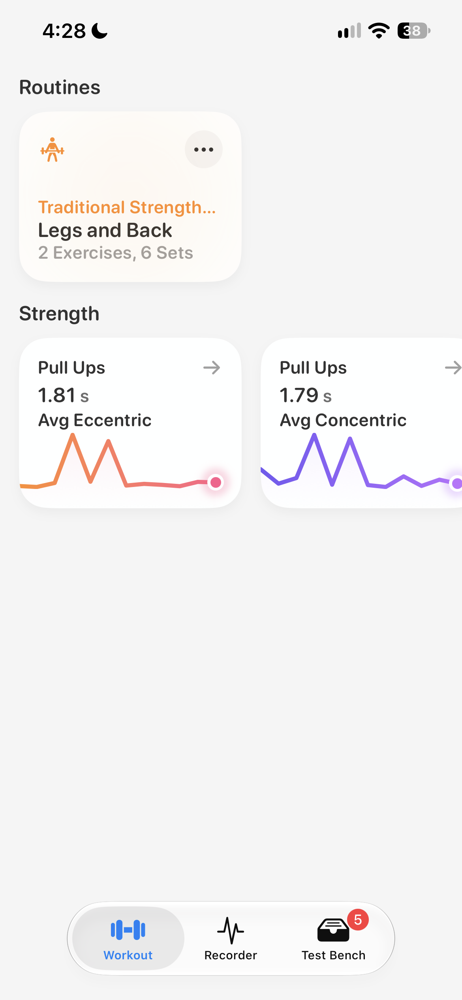

# muscle-contraction-timer
A Swift feature prototype for Bevel that uses AirPods and Apple Watch accelerometer data to determine the duration of eccentric, concentric, and isometric muscle contractions.

## Features

### 1. Motion Capture during Bevel's Set Recording

During a set recording like Bevel already features, the motion sensors in the target device (AirPods for example) track the users acceleration in the background.

  

---

### 2. Time Under Tension Metrics UI
Once a set is complete, the motion data captured during a user's set is split into `k` clusters containing an eccentric and concentric contraction phase. The completed rep count the user enters is what the algorithm uses to create its `k` clusters. The timings are also immediately shown to the user by programmatically displaying the ecc/conc timings on set completion.

The UI I designed for this features a horizontal pagination to display weight/reps and ecc/conc timings inline. I chose this design to keep the UI vertically compact. 

  

---

### 3. Behind the Scences with Displacement Curves
The algorithm denoises the incoming acceleration frames, integrates them into clean displacement data, and finally clusters the data based on local maximums where each cluster overlaps cleanly with each of my actual reps. 

  

---

### 4. Integrating the Metrics into the Progression UI
Integrating these new metrics is super easy using Bevel's existing progression UI. Having this data viewable before and after workouts is essential as it allows users to maintain consistent time under tension across their workouts. 

  

## Disclaimers

Images used in the app including the "Back Squat" image and "Pull up" image are property of Bevel Health and Finerpoint, Inc.

The UI design in this app replicates that of the Bevel iOS app and is property of Bevel Health and Finerpoint, Inc.

This project is purely for research and educational purposes only to present to the Bevel Health team and is not intended for any other purpose.
